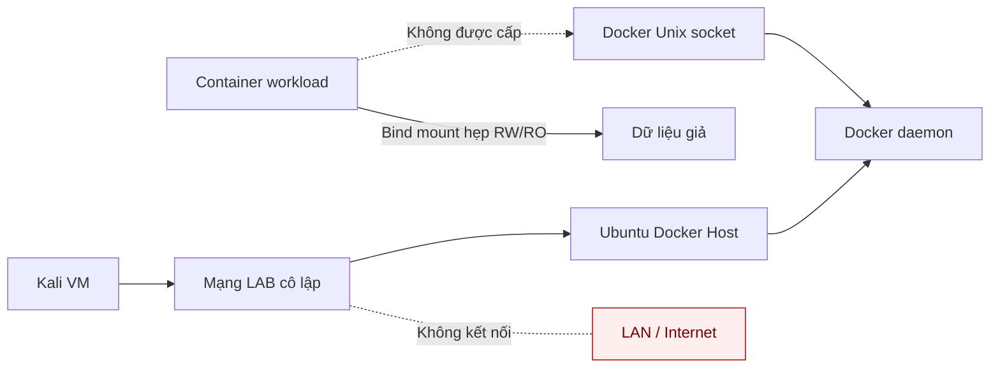

# Threat Model: Docker Host & Daemon

## Tài sản và ranh giới tin cậy

| Thành phần | Vai trò | Yêu cầu bảo vệ |
|---|---|---|
| Ubuntu Docker Host | Chạy daemon và container LAB | Giữ baseline, không ảnh hưởng máy thật |
| Docker daemon | Quản lý container/image/network/volume | Chỉ principal được phép truy cập |
| Unix socket | Kênh client giao tiếp daemon | Không mount vào workload |
| Container workload | Chạy test với dữ liệu giả | Không privileged/host namespace/device |
| Thư mục dữ liệu giả | Đích bind mount hẹp | Không chứa dữ liệu thật; cleanup được |
| Mạng LAB | Kết nối Kali–Ubuntu cô lập | Không NAT, gateway hoặc Internet |

## Các đường rủi ro

| Đường rủi ro | Tác động tiềm tàng | Kiểm soát |
|---|---|---|
| Docker socket trong container | Gửi yêu cầu quản trị tới daemon rootful | Không mount socket; kiểm tra metadata từ host |
| Principal có quyền ghi socket | Điều khiển daemon, thường tương đương quyền quản trị cao | Hạn chế nhóm `docker`; không đổi membership trong LAB |
| Bind mount read-write | Sửa/xóa dữ liệu host trong phạm vi mount | Path giả hẹp; chuyển sang read-only |
| Bind mount quá rộng | Mở rộng dữ liệu host bị tác động | Cấm mount `/` và thư mục nhạy cảm |
| Docker API TCP | Điều khiển daemon từ mạng nếu cấu hình không an toàn | Không bật TCP; kiểm tra `2375/2376` trước/sau |
| Privileged/host namespace/device | Giảm ranh giới cô lập | Không cấp nếu workload không cần |

## Giới hạn

LAB không thử container escape, không gửi API qua Docker socket từ container,
không bật daemon TCP và không thay đổi permission hay membership. Kết quả bind
mount chỉ chứng minh tác động trong đường dẫn dữ liệu giả đã khai báo.
