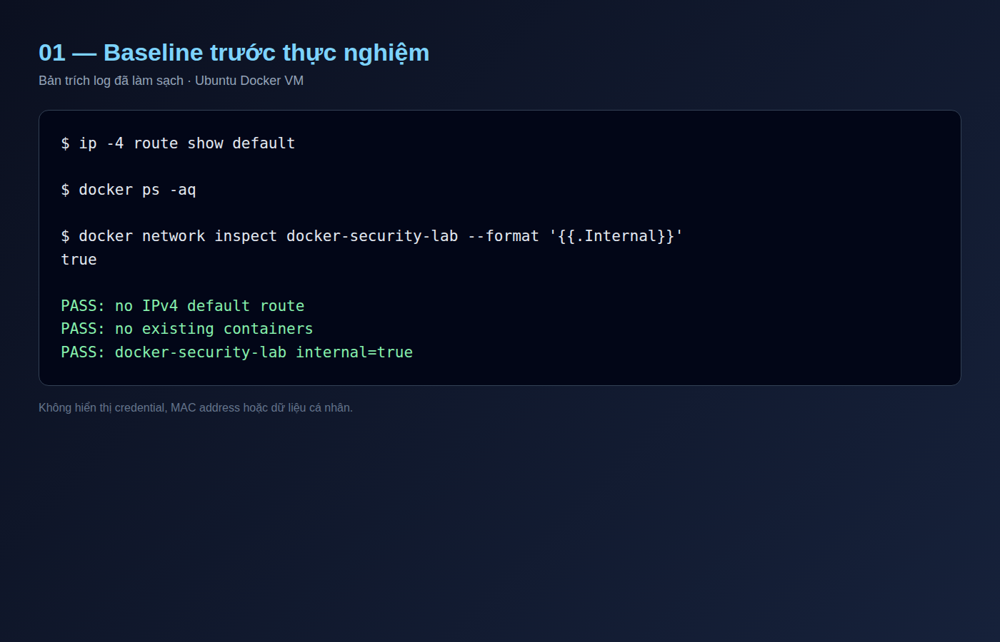
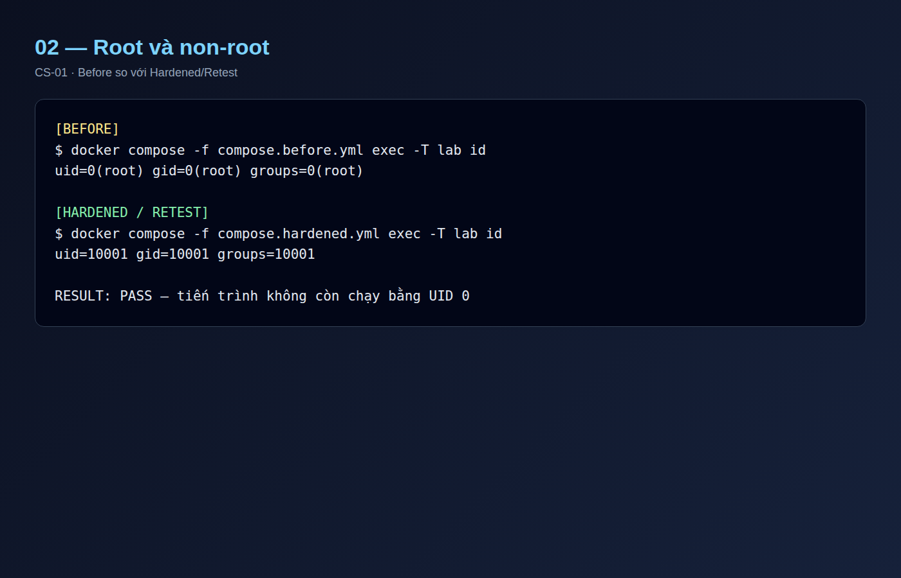
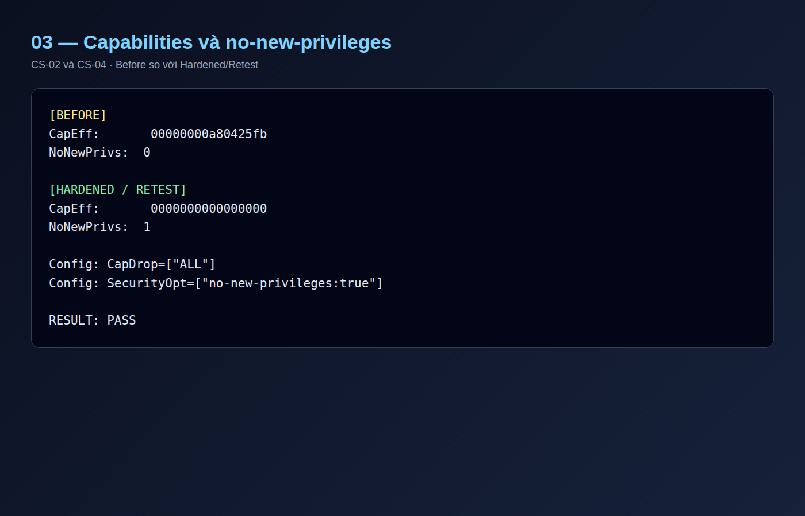
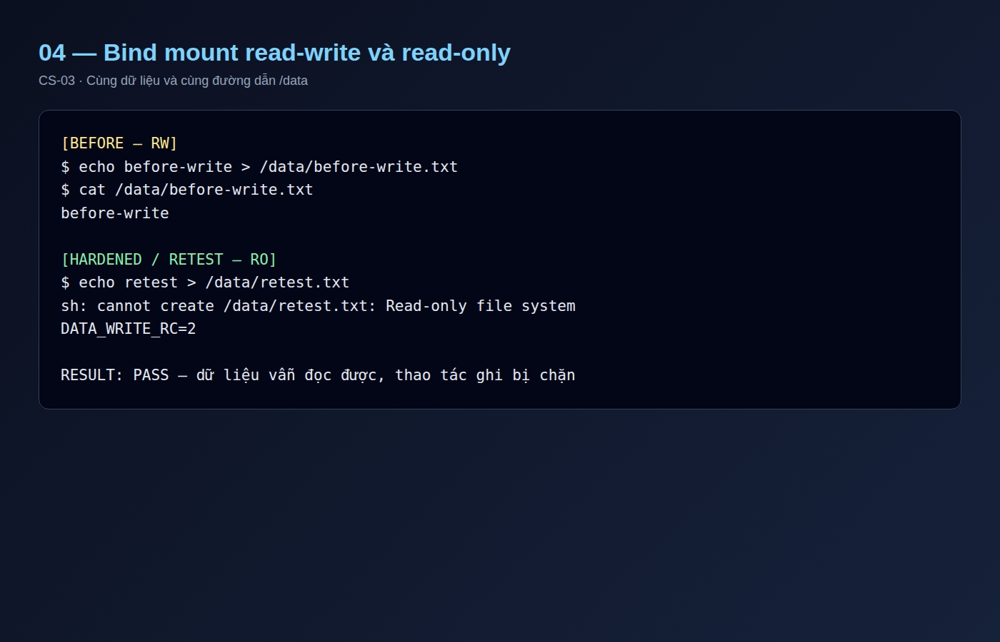
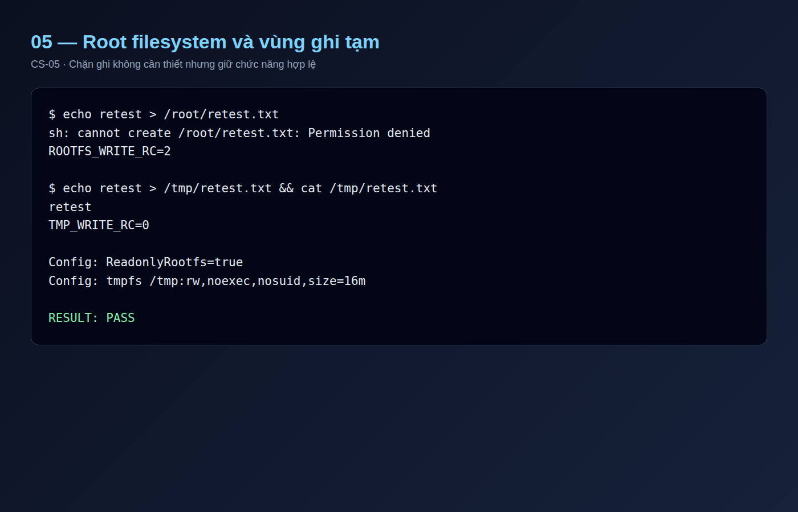
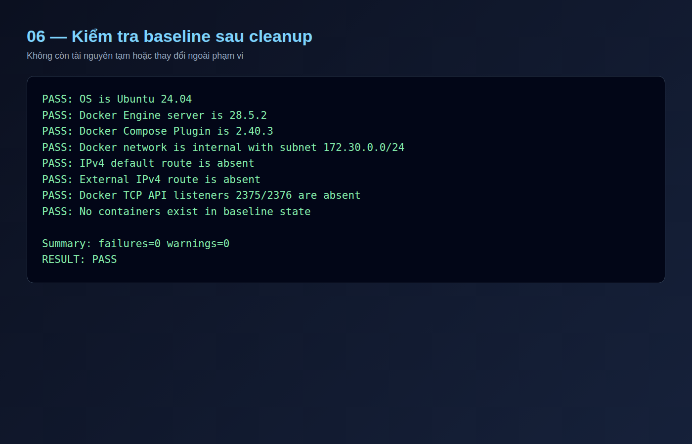
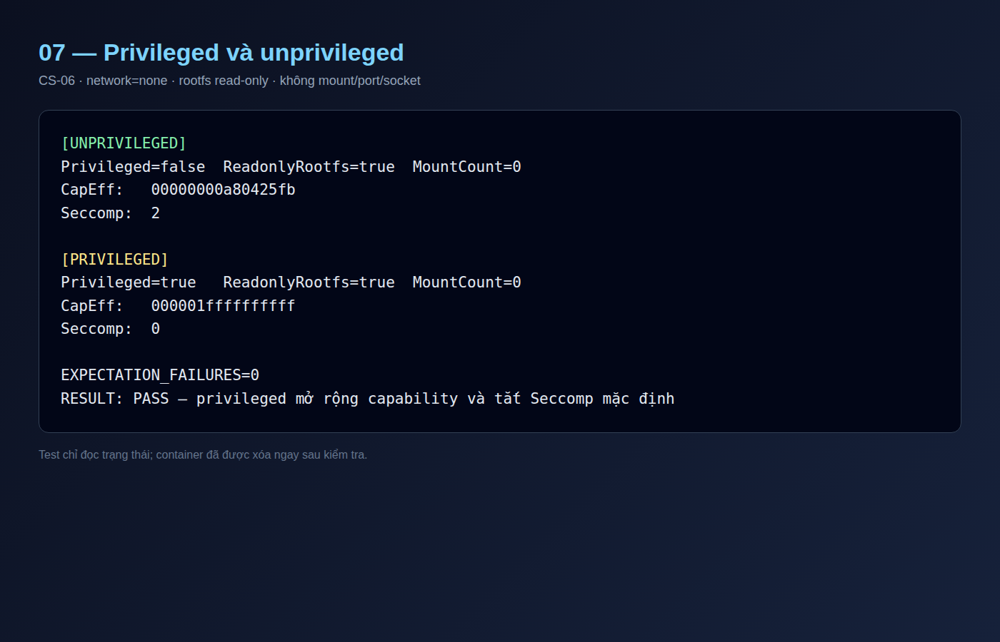

# Báo cáo thực nghiệm Container Security

## 1. Thông tin đề tài

**Đề tài:** Nghiên cứu, thực nghiệm khai thác và phòng chống các lỗ hổng bảo
mật trong môi trường Docker Container.

**Phần thực nghiệm:** Container Security — root/non-root, privileged,
Linux capabilities, `no-new-privileges`, bind mount và filesystem chỉ đọc.

## 2. Mục tiêu

Thực nghiệm so sánh một container được cấp quyền rộng với cùng workload sau
khi áp dụng nguyên tắc đặc quyền tối thiểu. Các test case kiểm tra danh tính
tiến trình, capability hiệu lực, khả năng tăng quyền và phạm vi filesystem có
thể ghi. Phiên bản harden phải chặn hành vi không cần thiết nhưng vẫn đọc được
dữ liệu đầu vào và ghi được dữ liệu tạm.

## 3. Phạm vi và nguyên tắc an toàn

LAB chỉ chạy trên VM thuộc nhóm trong mạng cô lập. Không tấn công hệ thống bên
ngoài, không bật `privileged`, không mount Docker socket, thiết bị hay thư mục
hệ thống của host. Docker daemon không được expose qua TCP. Dữ liệu mount vào
container là dữ liệu giả.

Thực nghiệm này đánh giá **cấu hình bảo mật container**, không khai thác CVE và
không chứng minh container escape hay chiếm quyền host. Phép so sánh privileged
chỉ đọc trạng thái tiến trình, không cấp network, mount, port hoặc Docker socket.

## 4. Môi trường thực nghiệm

- Ubuntu Server 24.04.5 LTS, kernel `6.8.0-146-generic`.
- Docker Engine `28.5.2`; Docker Compose Plugin `2.40.3`.
- Image được pin bằng digest:
  `ubuntu@sha256:2198e4c65076e9cb0b3d695219df667c0e3b0072da64ca3c2648aca17dcecaf5`.
- Docker network `docker-security-lab`: `172.30.0.0/24`, `internal=true`.
- Ubuntu Docker VM: `192.168.100.10/24`; Kali VM: `192.168.100.20/24`.
- Không có default route, DNS hay Internet trong lúc thực nghiệm.

## 5. Cơ sở lý thuyết

### 5.1 Root và non-root

Tiến trình có UID `0` là root bên trong container. Các namespace vẫn tạo ranh
giới cách ly với host, nhưng nếu ứng dụng hoặc runtime có lỗ hổng thì quyền cao
làm tăng mức độ tác động. Chạy bằng một UID không đặc quyền giúp giảm khả năng
sửa file, thay đổi cấu hình và thực hiện thao tác quản trị trong container.

### 5.2 Linux capabilities

Linux chia quyền root thành các capability riêng. Docker cấp một tập capability
mặc định thay vì toàn bộ quyền root. `cap_drop: [ALL]` loại bỏ chúng khi
workload không cần thao tác đặc quyền. Trường `CapEff` trong
`/proc/self/status` biểu diễn tập capability đang có hiệu lực.

### 5.3 `no-new-privileges`

Khi `NoNewPrivs=1`, tiến trình và tiến trình con không thể nhận thêm quyền qua
cơ chế như file setuid/setgid. Đây là lớp phòng vệ bổ sung, không thay thế việc
chạy non-root, drop capability hoặc chính sách Seccomp/AppArmor.

### 5.4 Bind mount và filesystem chỉ đọc

Bind mount `rw` cho phép container thay đổi dữ liệu tại đường dẫn tương ứng
trên host. Chuyển mount sang `ro` giảm nguy cơ sửa hoặc phá hủy dữ liệu. Tùy
chọn `read_only: true` khóa root filesystem của container; một `tmpfs` giới hạn
cho `/tmp` vẫn cung cấp vùng ghi tạm cần thiết mà không làm mất nguyên tắc bảo
vệ phần còn lại.

## 6. Quy trình thực nghiệm

Quy trình được thực hiện theo chuỗi:

**Research → Build → Test → Analyze → Harden → Retest → Compare → Document**.

Hai file Compose dùng cùng image, dữ liệu và network. Cấu hình Before chạy bằng
`0:0`, giữ capability mặc định, mount `/data` read-write và cho phép ghi root
filesystem. Cấu hình Hardened dùng:

```yaml
user: "10001:10001"
read_only: true
cap_drop:
  - ALL
security_opt:
  - no-new-privileges:true
tmpfs:
  - /tmp:rw,noexec,nosuid,size=16m
volumes:
  - ./lab-data:/data:ro
```

Mỗi bài kiểm tra dùng cùng thao tác ở Before và Retest. Sau khi thu kết quả,
Compose stack được gỡ và baseline được kiểm tra lại.

## 7. Kết quả thực nghiệm

| ID | Nội dung | Before | Hardened/Retest | Đánh giá |
|---|---|---|---|---|
| CS-01 | Danh tính tiến trình | `uid=0`, `gid=0` | `uid=10001`, `gid=10001` | PASS |
| CS-02 | Capability hiệu lực | `00000000a80425fb` | `0000000000000000` | PASS |
| CS-03 | Ghi bind mount `/data` | Ghi thành công | Bị chặn, RC `2`, read-only | PASS |
| CS-04 | Ngăn nhận thêm quyền | `NoNewPrivs=0` | `NoNewPrivs=1` | PASS |
| CS-05 | Phạm vi filesystem ghi được | Ghi rootfs thành công | `/root` bị chặn; `/tmp` ghi được | PASS |
| CS-06 | Privileged/unprivileged | Capability mặc định, `Seccomp=2` | Privileged: capability rất rộng, `Seccomp=0` | PASS |

Container ở cả hai cấu hình đều có `Privileged=false`. Phiên bản hardened còn
được xác nhận có `ReadonlyRootfs=true`, `CapDrop=["ALL"]`, bind mount `/data`
với `RW=false` và `SecurityOpt=["no-new-privileges:true"]`.

## 8. Phân tích

Ở cấu hình Before, workload mẫu không cần quyền quản trị nhưng vẫn chạy bằng
root, giữ capability mặc định và có thể thay đổi cả `/data` lẫn root
filesystem. Đây là quyền dư thừa và làm tăng bề mặt tác động nếu ứng dụng bị
khai thác.

Sau hardening, tiến trình không còn root hoặc capability hiệu lực, không thể
nhận thêm đặc quyền và không thể ghi vào dữ liệu đầu vào hay root filesystem.
Chức năng hợp lệ vẫn hoạt động: container đọc được `/data/sample.txt` và ghi
được file tạm trong `/tmp`. Vì vậy, hardening giảm quyền mà không phá vỡ yêu
cầu chức năng đã xác định.

Lỗi ghi `/root` là kết quả của nhiều lớp kiểm soát kết hợp, gồm UID non-root và
root filesystem chỉ đọc. Test này xác nhận hành vi bị chặn, nhưng không tách
riêng đóng góp của từng lớp.

Test `CS-06` cho thấy `--privileged` làm `CapEff` tăng từ
`00000000a80425fb` lên `000001ffffffffff` và Seccomp chuyển từ chế độ filter
(`2`) sang disabled (`0`). Vì vậy privileged làm giảm nhiều ranh giới bảo vệ và
không nên dùng nếu workload có thể hoạt động với capability cụ thể.

## 9. Kiểm tra sau thực nghiệm

Sau `docker compose down`, kết quả kiểm tra baseline là:

- Không còn container chạy hoặc dừng.
- Docker network vẫn `internal=true`, subnet `172.30.0.0/24`.
- Không có IPv4 default route hoặc external route.
- Không có Docker TCP listener trên `2375/2376`.
- Kali VM vẫn giao tiếp được với Ubuntu VM qua mạng LAB.
- Script validation trả về `failures=0`, `warnings=0`, `RESULT: PASS`.

## 10. Bằng chứng và khả năng tái hiện

Log gốc được giữ cục bộ trong Ubuntu VM và không commit lên Git:

```text
01-container-security/evidence/20261112-CS-before.txt
01-container-security/evidence/20261112-CS-hardened-retest.txt
01-container-security/evidence/CS-06-privileged-comparison.txt
```

SHA-256 của log Retest:

```text
dfbf2e687ee2ad1a84de96c1523a9fd513ddcede611d7e324d6838dab218e4b6
```

SHA-256 của log so sánh privileged:

```text
4eaf72c84aca0859c4400c36a12455e2d14de27d3031f7710365eb705eeb96c5
```

Các cấu hình và hướng dẫn tái hiện nằm trong `01-container-security/`.

## 11. Giới hạn

- Chế độ privileged chỉ được bật trong một container tạm thời, không network,
  mount, port hoặc Docker socket; lệnh test chỉ đọc trạng thái tiến trình.
- Không kiểm thử container escape, kernel exploit, Docker socket hay host
  filesystem mount.
- Không đánh giá AppArmor, Seccomp tùy chỉnh, resource limits hoặc phát hiện
  sự kiện; các nội dung này thuộc LAB Hardening, Audit & Detection.
- Kết quả chỉ áp dụng cho image và workload mẫu đã kiểm thử.

## 12. Kết luận và khuyến nghị

Thực nghiệm chứng minh nguyên tắc least privilege có thể giảm đáng kể quyền
của container mà vẫn giữ chức năng cần thiết. Container nên chạy non-root,
drop mọi capability không cần thiết, bật `no-new-privileges`, dùng root
filesystem read-only và chỉ cấp quyền ghi tại vị trí được kiểm soát. Bind mount
nên mặc định read-only; image phải được pin bằng digest và kiểm thử lại sau mỗi
thay đổi cấu hình.

## 13. Danh sách ảnh cần chèn vào báo cáo/slide

1. Baseline validation trước LAB.
2. Kết quả `id` ở Before và Hardened.
3. `CapEff` và `NoNewPrivs` trước/sau.
4. Ghi `/data` thành công ở Before và bị chặn ở Retest.
5. Ghi rootfs bị chặn nhưng `/tmp` thành công ở Retest.
6. Baseline validation `RESULT: PASS` sau cleanup.
7. So sánh capability và Seccomp giữa privileged/unprivileged.

Ảnh phải che hostname không cần thiết, credential, MAC address và dữ liệu cá
nhân. Không chèn mật khẩu, token hoặc nội dung nhạy cảm vào báo cáo.

### Ảnh minh chứng đã làm sạch














