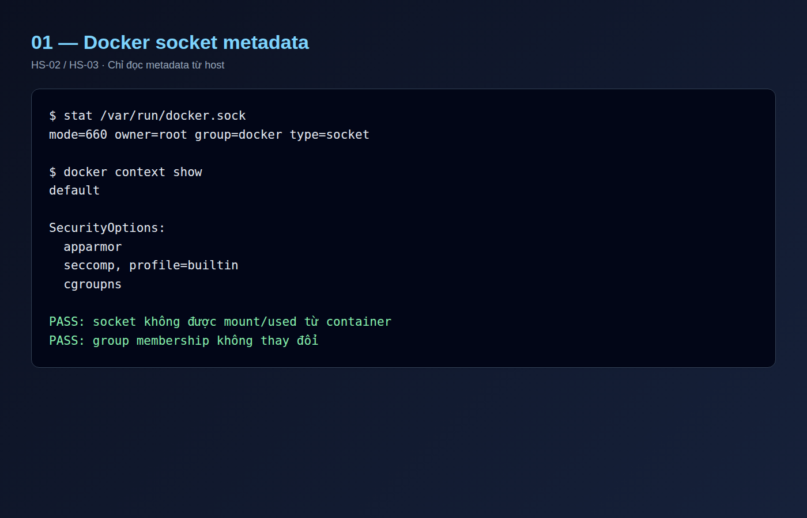
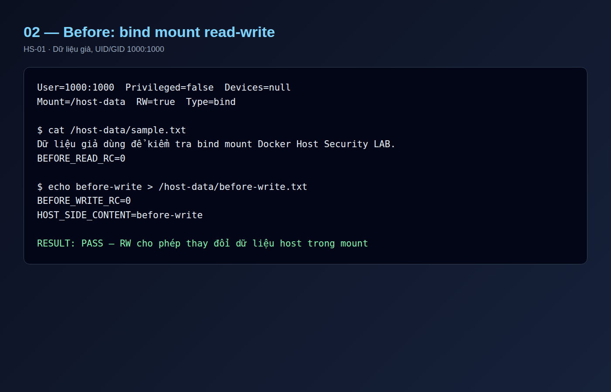
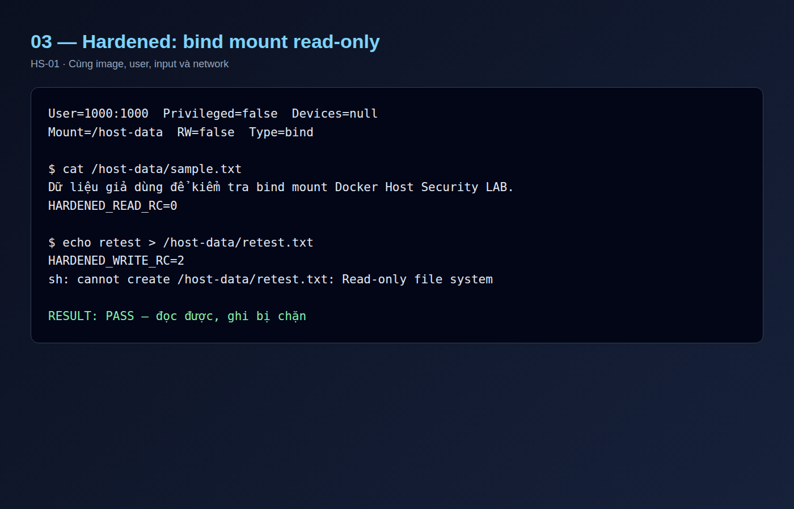
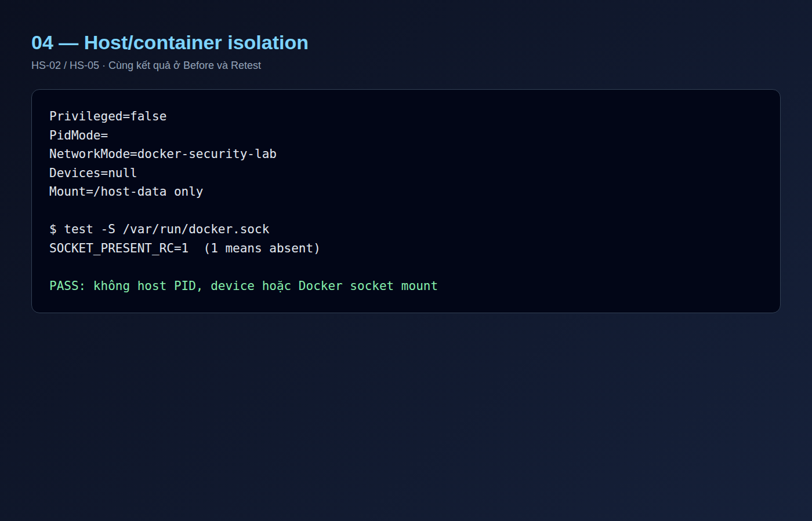
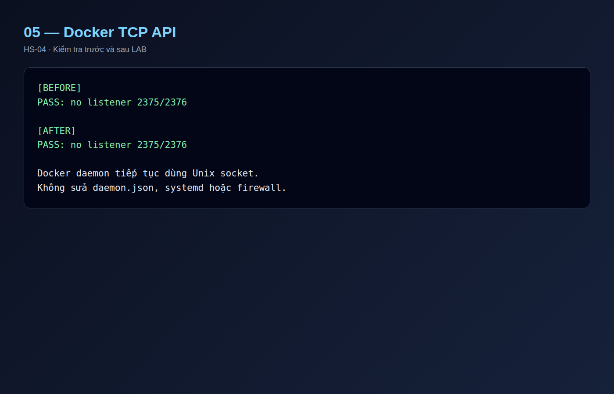
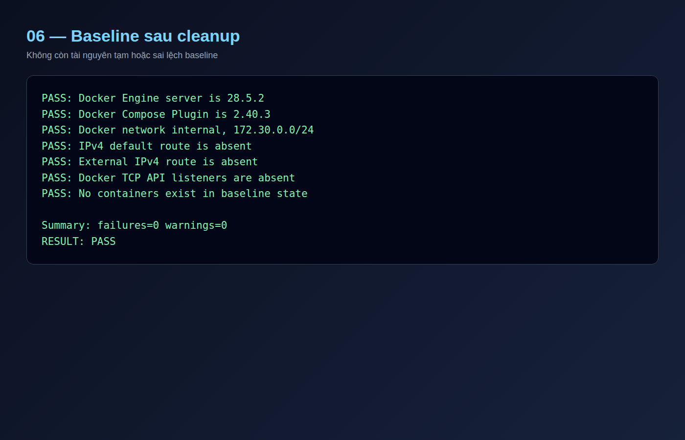

# Báo cáo thực nghiệm Docker Host & Daemon Security

## 1. Mục tiêu

Đánh giá ranh giới tin cậy giữa Docker container, Unix socket, daemon và
Ubuntu host; thực nghiệm tác động của bind mount read-write/read-only; xác minh
daemon không expose TCP và workload không nhận quyền host ngoài phạm vi.

## 2. Phạm vi an toàn

LAB chỉ dùng thư mục dữ liệu giả. Không mount Docker socket, `/`, `/etc`,
`/var`, thiết bị hoặc dữ liệu thật. Không đổi `daemon.json`, systemd, socket
permission, nhóm `docker`, firewall, route, NIC, snapshot hoặc Docker network.
Không bật Docker TCP API và không thử container escape.

## 3. Môi trường

- Ubuntu Server 24.04.5 LTS; Docker Engine `28.5.2`.
- Docker Compose Plugin `2.40.3`.
- Image Ubuntu 24.04 được pin bằng digest.
- Docker network `docker-security-lab`, `172.30.0.0/24`, `internal=true`.
- Ubuntu VM `192.168.100.10/24`; không có default route hoặc Internet.

## 4. Cơ sở lý thuyết

Docker client thường giao tiếp với daemon rootful qua Unix socket. Principal có
quyền ghi socket có thể yêu cầu daemon tạo container, mount dữ liệu hoặc quản
lý tài nguyên; vì vậy quyền này cần được xem như quyền quản trị cao. Mount
socket vào workload làm mất ranh giới quan trọng giữa container và daemon.

Bind mount ánh xạ trực tiếp đường dẫn host vào container. Mount read-write cho
phép tiến trình sửa dữ liệu host trong phạm vi mount và quyền filesystem.
Read-only giữ khả năng đọc nhưng chặn thay đổi qua đường dẫn đó. Read-only cho
một mount không đồng nghĩa toàn bộ root filesystem của container đã read-only.

## 5. Thiết kế kiểm thử

| ID | Nội dung |
|---|---|
| HS-01 | So sánh bind mount `/host-data` RW và RO |
| HS-02 | Đọc metadata socket từ host; xác nhận không mount vào workload |
| HS-03 | Phân tích quyền group socket mà không đổi membership |
| HS-04 | Kiểm tra listener TCP `2375/2376` trước và sau |
| HS-05 | Inspect privileged, PID namespace, device và mount |

Hai cấu hình dùng cùng image, UID/GID `1000:1000`, input và network. Biến duy
nhất của HS-01 là tùy chọn mount `rw` hoặc `ro`.

## 6. Kết quả

| Test | Before | Hardened/Retest | Đánh giá |
|---|---|---|---|
| HS-01 | Đọc RC `0`, ghi RC `0`; host thấy `before-write` | Đọc RC `0`, ghi RC `2`, read-only | PASS |
| HS-02 | Socket chỉ được quan sát từ host | Socket không tồn tại trong container | PASS |
| HS-03 | Socket mode `660`, owner `root`, group `docker` | Membership không thay đổi | PASS |
| HS-04 | Không có listener `2375/2376` | Vẫn không có listener | PASS |
| HS-05 | Unprivileged, không host PID/device | Giữ nguyên isolation | PASS |

Docker security options quan sát được gồm AppArmor, Seccomp builtin và cgroup
namespaces. Mỗi workload chỉ có một bind mount `/host-data`; Before có
`RW=true`, Hardened có `RW=false`.

## 7. Phân tích

Kết quả chứng minh bind mount RW cho phép container thay đổi trực tiếp dữ liệu
host trong đường dẫn được chia sẻ. Khi chuyển cùng mount sang RO, chức năng đọc
vẫn hoạt động nhưng thao tác ghi bị kernel từ chối. Do đó mount nên mặc định là
read-only và chỉ cấp write cho đường dẫn hẹp thực sự cần thiết.

Socket mode `660` cho owner và group quyền đọc/ghi. Việc daemon là rootful làm
cho quyền gửi yêu cầu tới socket có tác động lớn hơn quyền filesystem thông
thường. Kiểm soát phù hợp là không mount socket vào workload, giới hạn thành
viên nhóm `docker` và giữ daemon trên Unix socket thay vì expose TCP.

## 8. Sai lệch và hiệu chỉnh

Lần chạy đầu dùng container root nhưng đã drop toàn bộ capability, trong khi
thư mục giả thuộc UID `1000`; thao tác ghi Before bị từ chối nên không đạt điều
kiện đối chứng. Log đó được giữ với hậu tố `attempt1` và không dùng để kết luận.

Thiết kế được sửa để cả hai cấu hình dùng UID/GID `1000:1000`, khớp chủ sở hữu
thư mục giả. Không `chmod` hoặc nới quyền host. Lần chạy lại đạt đúng kỳ vọng và
chỉ thay đổi thuộc tính RW/RO giữa hai cấu hình.

## 9. Cleanup và baseline

- Không còn container chạy hoặc dừng.
- File thử nghiệm đã được xóa khỏi thư mục dữ liệu giả.
- Docker network vẫn `internal=true`.
- Không có default/external route hoặc listener Docker `2375/2376`.
- Baseline validation: `failures=0`, `warnings=0`, `RESULT: PASS`.

## 10. Evidence

Log hợp lệ được giữ cục bộ trong Ubuntu VM:

```text
02-host-security/evidence/HS-01-to-HS-05.txt
```

SHA-256:

```text
8d781a45c2e19182ccfab07a25af41f7a36e7808002cc2a69147dae2f5bad259
```

Log thô không commit lên repository. Ảnh minh chứng bên dưới được dựng từ các
đoạn log đã làm sạch, không chứa credential, MAC address hoặc dữ liệu cá nhân.

## 11. Kết luận

Docker socket và quyền nhóm `docker` là ranh giới quản trị quan trọng; không
nên cấp cho workload thông thường. Bind mount phải dùng path tối thiểu và ưu
tiên read-only. LAB xác nhận hardening này chặn ghi ra host mà vẫn duy trì chức
năng đọc, đồng thời không thay đổi daemon hoặc baseline mạng.

## 12. Ảnh minh chứng












